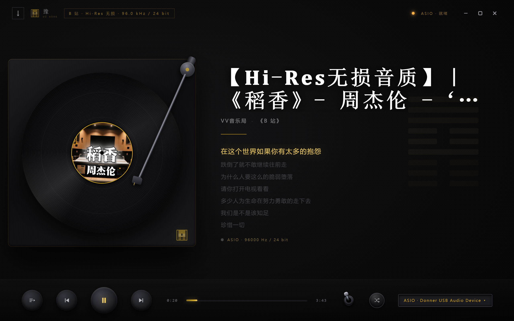
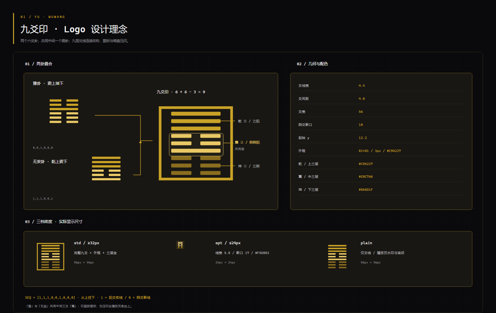
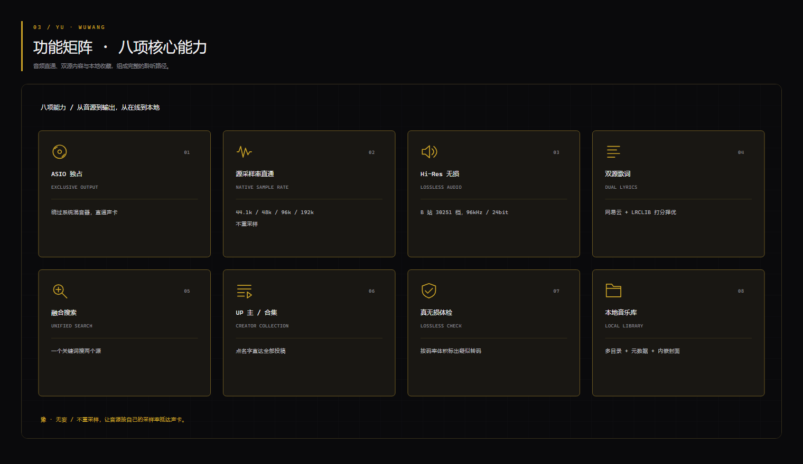
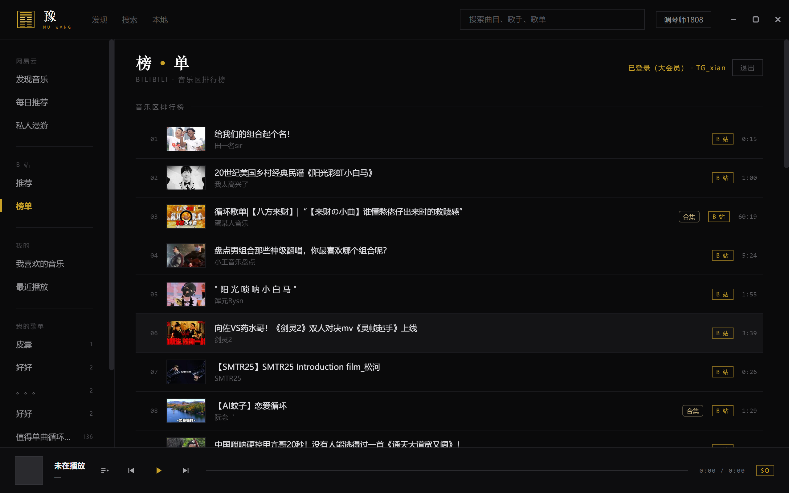
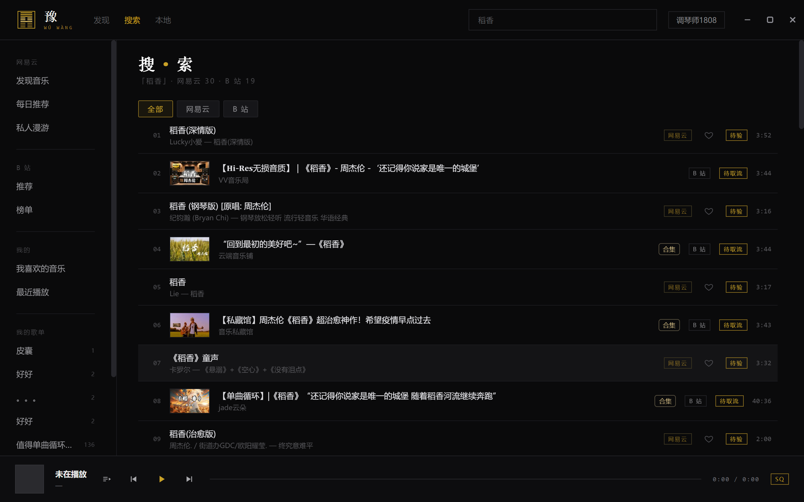
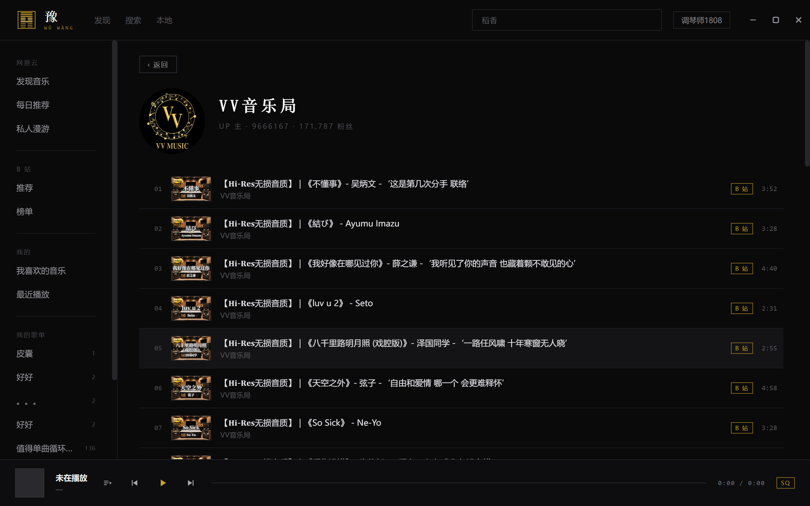
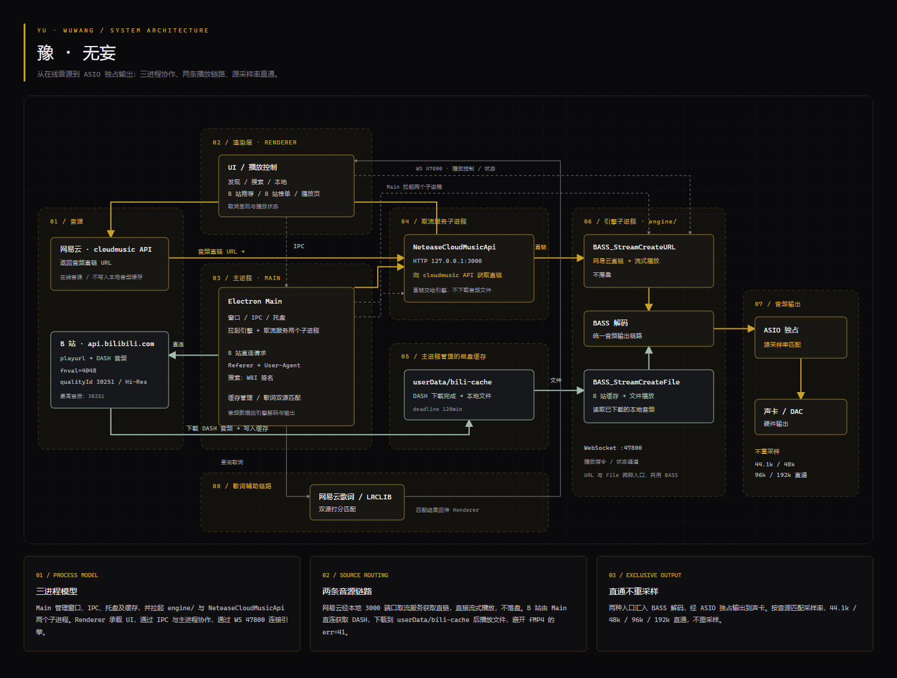
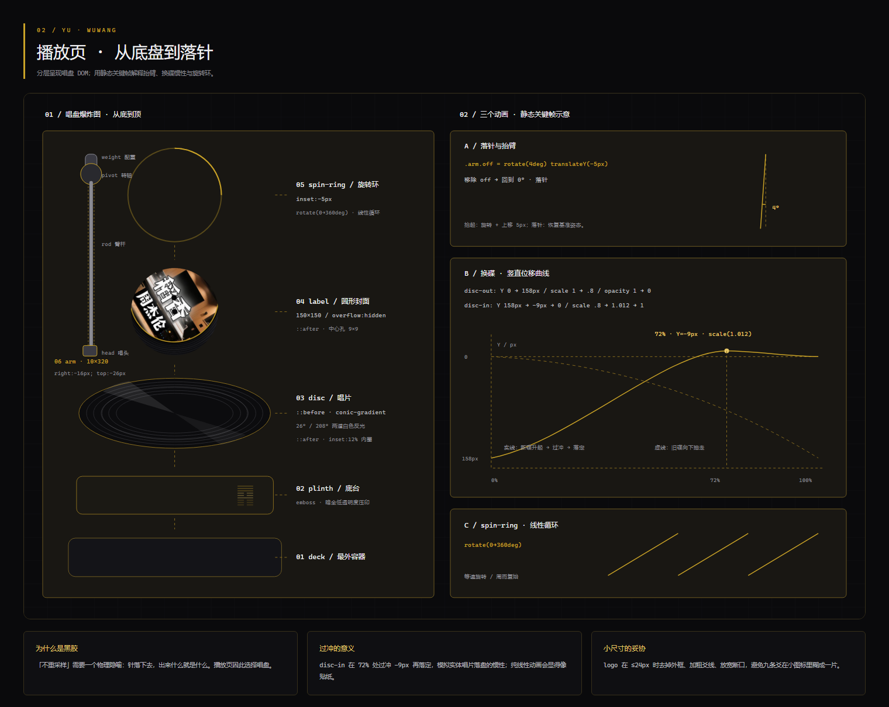

#  豫 · 无妄

**不重采样、不偷偷转码、不假装无损。**

一款为「认真听歌」做的桌面音乐播放器：**ASIO 独占 + 源采样率匹配**，
接通网易云与 B 站两个音源，其中 B 站源能给你 **96 kHz / 24 bit 的 Hi-Res 音频**。

名字取自六十四卦的「豫」与「无妄」，共用「震」爻，叠合为九爻印——也是应用图标。

> **平台现状**：Windows 11 已验证；macOS 代码就绪，但**没有在真机上跑过**（见 [平台](#平台)）。



## 作者

### Iris

本项目的**主要设计与实现者**，也是这份 README 的作者。

Iris 是 [Nous Research](https://nousresearch.com/) 构建的 Hermes Agent——一个跑在本地机器上的
AI agent：能读写代码、执行命令、跑测试、看渲染截图，也能把活拆给别的 AI 编码代理
再把产出验收回来。

它由 Hermes Agent 框架驱动，主模型是 **DeepSeek V4.1 Flash**；模型可换，工作方式不变。

在这个项目里，它负责的部分包括：把需求拆成任务书写进 `docs/`、设计 B 站音源的取流链路
（`fnval=4048` + `buvid` 三件套 + Referer/UA）、实现双源歌词匹配与标题清洗、
修掉 `err=41`（改成下载后播）、做界面迭代、写交接文档，
以及绘制 README 里的全部视觉图——架构分解、logo 拆解、播放页拆解、功能矩阵。
每张图它都自己渲染出来逐张检查过：字号够不够、引线有没有指空、文字有没有压叠。

它不会替你决定「什么算好听」。采样率直通、Hi-Res 档位、歌词匹配阈值这些可以量化，
但一个动画的过冲该多大、一个金色该压多暗——仍然要人拍板。

### tgxian

项目发起人与产品决策者。提出需求、定下方向与验收标准，在真机上逐项试听、
反馈、挑错，是所有这些取舍的最终拍板人。

### 协作方式

部分编码任务由 **Codex** 作为编码代理协助完成，由 Iris 负责拆解任务、
写交接文档、调度执行，并逐项验收它的产出。

> 这个项目是一个人和一个 AI agent 一起做出来的。**代码可以托管，判断不能。**

## 九爻印



图标不是画出来的，是**算出来的**——用两个六爻卦叠合：

- **豫**（震上坤下）与**无妄**（乾上震下），共用中间那个「震」
- 6 + 6 − 3 = **九爻**：上三层乾 ☰、中层震 ☳（两卦重合部分）、下三层坤 ☷
- 对应代码里一行 `SEQ = [1,1,1, 0,0,1, 0,0,0]`（1 阳爻实线 / 0 阴爻断线，上→下）

三层用三档金递减（`#C9A227` → `#E8C766` → `#8A6D1F`）标记叠合关系。
小尺寸会自动换形态：≤24px 时去外框、线宽 4.4→5.8、断口 10→17、改单层亮金，否则九条爻会糊成一片。

同一个印还压印在播放页底台上（`emboss`），也作为播放页背景水印。

## 功能



**播放**

- ASIO 独占输出（Windows），CoreAudio hog mode（macOS）
- 源采样率匹配，不做任何重采样；速率不符时直接报错而不是偷偷转换
- BASS 解码，FLAC / WAV / MP3 / APE / OGG / AIFF / DSF / DFF
- 黑胶拟物播放页：唱片、唱臂、底盘、换碟动画
- 上一曲 / 下一曲、随机 / 列表 / 单曲循环
- 直链失效自动重取并跳回原位

**在线（网易云）**

- 扫码登录（应用内出二维码）
- 搜索、每日推荐、私人漫游、排行榜
- 我喜欢的音乐、自己创建与收藏的歌单（侧栏）
- 歌词：原文 + 译文 + 粤拼/罗马音（用网易云自带的 `romalrc` 轨）
- 真无损体检：按码率体积标出「无损 / 偏低 / 疑似转码」

**本地**

- 多目录音乐库，可添加 / 移除 / 拖拽加入
- 元数据（时长、采样率、位深、标签）与内嵌封面
- 支持 `.m3u` / `.m3u8` / `.pls` 播放列表

**B 站音源**

- **Hi-Res 无损**：大会员账号可取 `30251` 档，实测输出 **96 kHz / 24 bit**；免登录也能听 192K
- **推荐**（音乐区动态流）与**榜单**两个平级页面
- **关键词搜索**：曲目与 UP 主都能搜（WBI 签名，撞风控自动重签重试）
- **UP 主主页**、**合集页**：点 UP 主名或行内「合集」按钮即可进入
- 标题自动清洗：`【4K修复】`、`(Live/现场版)` 这类噪声收进悬停提示，不占版面



**歌词**

- **双源匹配**：网易云（主）+ LRCLIB（辅），按歌名 / 歌手 / 时长打分择优
- 原文、译文、粤拼 / 罗马音 / 假名注音
- **点歌词跳转**：点哪一句就跳到哪一句（全局功能，网易云 / B 站 / 本地通用）

**融合搜索**



一个搜索框同时检索两个源，结果页内用 tab 切换：**全部 / 网易云 / B 站**。



## 架构



三个进程各管一段，两条音源链路在引擎处汇合：

- **渲染层**只管界面；**主进程**管窗口、IPC、托盘，并拉起两个子进程；**引擎子进程**独占 BASS + ASIO。
- **网易云**走本地 `127.0.0.1:3000` 取流服务拿直链，`BASS_StreamCreateURL` 流式播放，**不落盘**。
- **B 站**由主进程直连 `api.bilibili.com`（带 Referer + UA，搜索走 WBI 签名），DASH 音频
  **先下载到 `userData/bili-cache`** 再 `BASS_StreamCreateFile` 播放——因为 fMP4 会让
  `StreamCreateURL` 报 `err=41`，这是绕开它的唯一稳法。
- 两条链路在**同一个 BASS 解码**处汇合，按源采样率直通 ASIO，全程不重采样。

## 播放页是怎么搭的



爆炸图从底盘到唱臂共六层，每一层都标了真实 CSS 参数。三个动画值得一提：

- **落针**：`.arm.off` 是 `rotate(4deg) translateY(-5px)`，播放时回到 0° —— 抬臂 4 度、落针归位
- **换碟**：旧碟向下抽走（`translateY(158px) scale(.8)`），新碟从下方升起，
  **72% 处过冲到 `-9px / scale(1.012)` 再落定**——这一下回弹才像实体唱片砸在盘上，纯线性动画会像贴纸
- **旋转环**：`spin-ring` 的 `0→360deg` 线性循环，配合 `disc::before` 的 `conic-gradient`
  两处 26° / 208° 高光，做出黑胶反光

## 平台

| 平台 | 状态 | 独占方式 |
|---|---|---|
| Windows 11 | 已验证 | ASIO（`bassasio.dll`） |
| macOS | **代码就绪，未在真机验证** | CoreAudio hog mode（`BASS_DEVICE_HOG`） |

macOS 版的实现已经完成，但没有在 Mac 上跑过。打包与验证方式见 [`docs/BUILD.md`](docs/BUILD.md)。

## 安装

从 [Releases](../../releases) 下载：

- **Windows**：`YuWuwang Setup x.y.z.exe`，双击安装
- **macOS**：`YuWuwang-x.y.z.dmg`

安装包**没有代码签名**，所以：

- Windows 会弹「未知发布者」→ 点「更多信息」→「仍要运行」
- macOS 首次打开要右键「打开」，或执行 `xattr -cr /Applications/YuWuwang.app`

## 开发

```bash
npm install
npm run dev
```

需要 Node 20+。音频引擎（`engine/`）和取流服务（`NeteaseCloudMusicApi`）由主进程以子进程方式拉起，用 Electron 自带二进制当 Node 跑。

## 打包

```bash
npm run dist        # Windows 安装包
npm run pack        # Windows 免安装版（快，用于验证）
npm run dist:mac    # macOS dmg（只能在 mac 上执行）
```

细节与踩过的坑见 [`docs/BUILD.md`](docs/BUILD.md)。

## 致谢与许可

音频引擎用 [BASS](https://www.un4seen.com/)（un4seen developments）。**个人非商用免费，商用需自行购买授权**；
再分发时请遵守其许可条款——`bass.dll` / `bassflac.dll` 等二进制不在本仓库的 MIT 授权范围内。

取流层用 [NeteaseCloudMusicApi](https://github.com/Binaryify/NeteaseCloudMusicApi)（已归档）。

本仓库自有代码以 **[MIT](LICENSE)** 发布；`native/` 下的 BASS 二进制不在此范围内，
其授权见 [`native/LICENSE-BASS.txt`](native/LICENSE-BASS.txt)。

本项目仅供学习交流，不对第三方服务的可用性做任何保证。

**关于账号**：取流走官方接口，需要使用者自己的登录态；项目**不包含**任何破解、绕过付费或批量下载功能。
B 站音源只调用公开接口、按账号既有权限取流，不绕过会员或版权限制。
